# Measurement passport `pilot_gpt4o_mini_v34`

## Totals

- points: 2958 published, 2958 answered
- tokens: prompt 7850106, response 8091766 (provider counters)
- money: **$6.0326** - cost of the published points (provider tokens × the tariff of the measurement)
- Bernoulli trials: 642430 in 2958 answered points - these are not model requests
- **provider counters are incomplete**: 6 billed points without counters - the token sums and the money are understated

Passport alarms (1):

- warning `INCOMPLETE_TOKEN_COUNTERS`: some billed points carry no provider token counters: the token sums and the money are understated, and the missing part cannot be recovered

## Capacities and loads

### `vspmr_glmm_v1`

| Quantity | Value ± 1.96·SE | Unit | Status | Note |
|---|---|---|---|---|
| IEC, q = 0.95 | 36.58 ± 5.41 (binned) · 38.06 ± 6.13 (by law) | rules | `measured` · `measured` | how many rules the model holds above level 0.95; the gap between the two calculations measures the approximation |
| IEC, q = 0.5 | 43.90 ± 6.62 (binned) · 46.09 ± 6.61 (by law) | rules | `measured` · `measured` | how many rules the model holds above level 0.5; the gap between the two calculations measures the approximation |
| IGC, q = 0.95 | 18.69 ± 3.62 (binned) · 17.55 ± 4.04 (by law) | rules | `measured` · `measured` | how many rules the model holds above level 0.95 when every word of the text is replaced (p = 1); the gap between the two calculations measures the approximation |
| IGC, q = 0.5 | 29.51 ± 5.92 (binned) · 29.76 ± 5.11 (by law) | rules | `measured` · `measured` | how many rules the model holds above level 0.5 when every word of the text is replaced (p = 1); the gap between the two calculations measures the approximation |
| price of a position doubling | 2.67 ± 0.310 | logit/doubling | `measured` | logit lost per doubling of the word position on the fatigue slope |
| FEC, q = 0.95 | 3277.37 ± 571.30 (by law) | words | `measured` | word position where accumulated fatigue exhausts the level-0.95 reserve; texts measured up to 10240 words |
| FEC, q = 0.5 | 11890.01 ± 1838.58 (by law) | words | `extrapolated` | word position where accumulated fatigue exhausts the level-0.5 reserve; texts measured up to 10240 words |
| price of a volume doubling | 1.60 ± 0.434 | logit/doubling | `measured` | logit lost when the text length doubles |
| loss at full density | 9.35 ± 1.01 | logit | `measured` | logit lost when every word of the text is replaced (p = 1) |
| late-rule degradation factor | 1.67 ± 0.234 | times/doubling | `measured` | how many times the degradation grows when the rule number doubles |
| late-rule degradation scale | 0.0412 ± 0.0398 | logit | `measured` | coefficient of the power part of the rule-number law |
| rule-set discount per doubling | -0.427 ± 0.100 | logit/doubling | `measured` | level change when the number of rules in the table doubles |

## Figures

### `vspmr_glmm_v1`

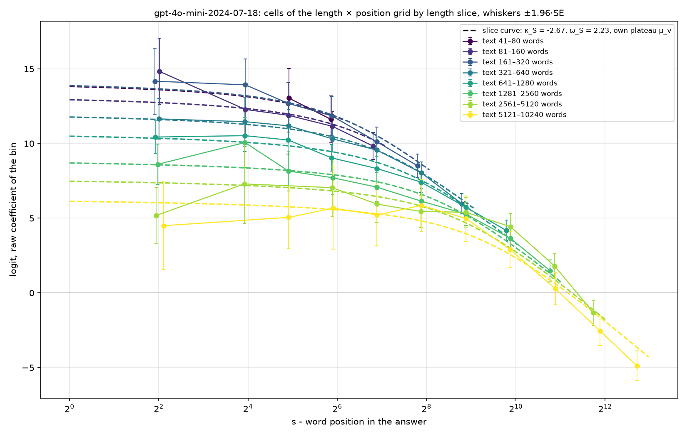

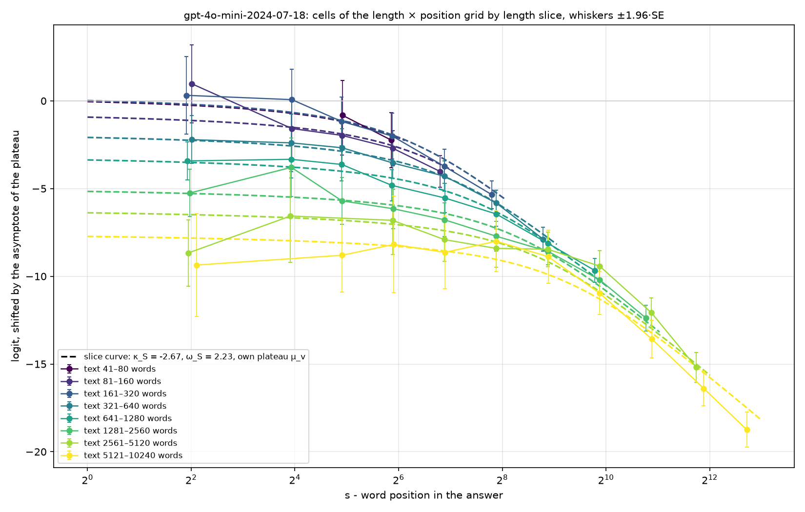

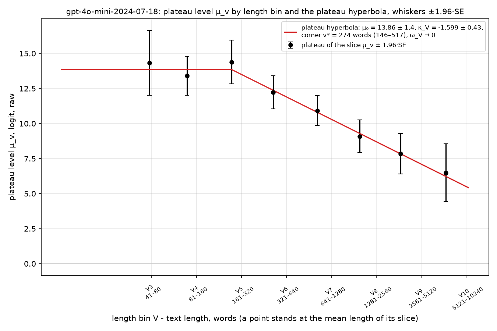

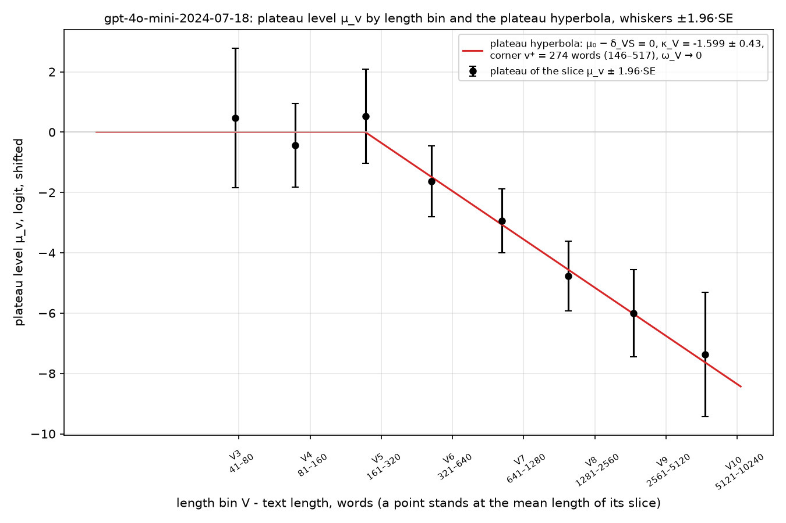

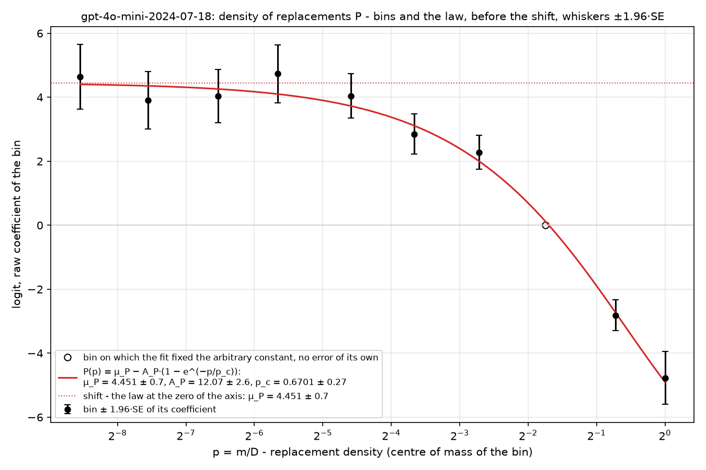

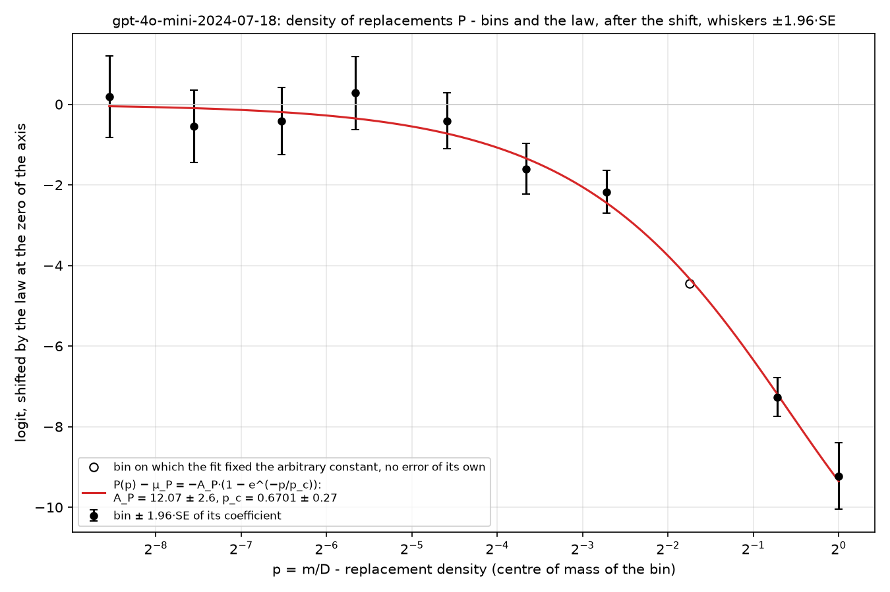

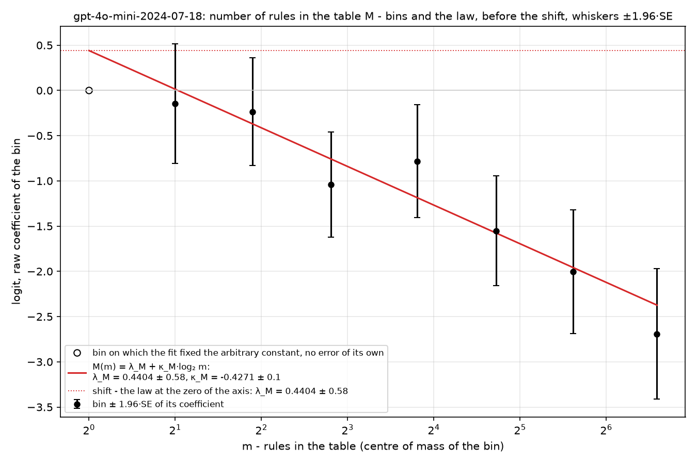

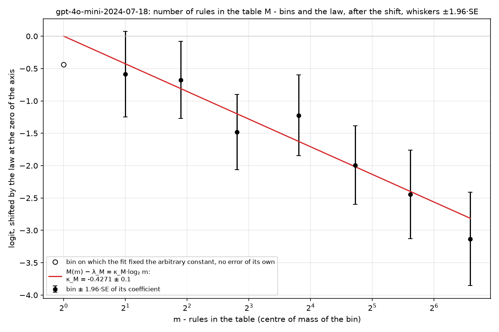

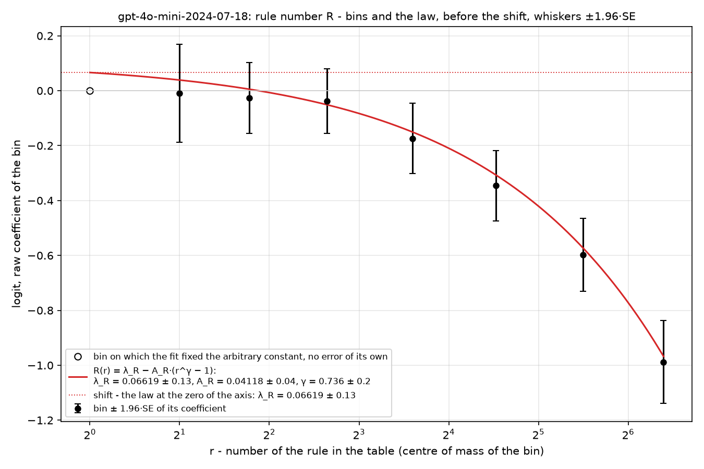

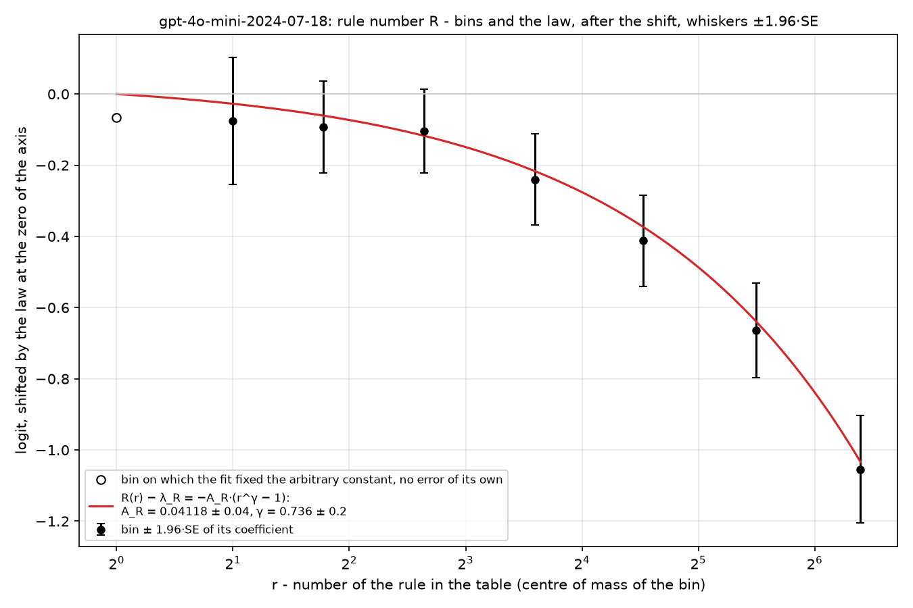

## Model parameters

### `vspmr_glmm_v1`

The passport model VS-PMR (`vspmr_glmm_v1`) gives the logit of a right replacement as

$$\eta = VS(v, s) + P(p) + M(m) + R(r) + b, \qquad b \sim N(0, \sigma^2)$$

$b$ is the shift of a point, shared by all its trials and integrated out of the likelihood; the bins and laws describe the median point ($b = 0$). A capacity keeps its meaning - the share of right replacements over all points - so the level $q$ is read at the threshold $\eta^*(q, \sigma^2)$ at which the median point gives the share $q$.

The second stage draws a law of its axis through the bins of every block:

$$VS = \tfrac{1}{2}\Big[(\lambda_S + \kappa_S\ell) + \mu(v) - \sqrt{(\lambda_S + \kappa_S\ell - \mu(v))^2 + \kappa_S^2\omega_S^2}\Big], \qquad \ell = \log_2 s$$

$$\mu(v) = \mu_0 + \tfrac{\kappa_V}{2}\Big[\log_2\tfrac{v}{v_{*}} + \sqrt{\log_2^2\tfrac{v}{v_{*}} + \omega_V^2}\Big]$$

$$P(p) = \mu_P - A_P\big(1 - e^{-p/p_c}\big), \qquad M(m) = \lambda_M + \kappa_M \log_2 m, \qquad R(r) = \lambda_R - A_R\,(r^{\gamma} - 1)$$

Here $s$ is the word position in the answer, $v = D \cdot n$ the text length in words, $p = m/D$ the replacement density, $m$ the number of rules and $r$ the rule number. The surface law is fitted in two steps: every length slice has its own plateau $\mu_v$ with shared $\kappa_S$, $\lambda_S$, $\omega_S$, and the plateau $\mu(v)$ is a hyperbola in the text length drawn through the $\mu_v$: the horizontal asymptote $\mu_0$ for short texts and the slope $\kappa_V$ per doubling for long texts, with the corner at the length $v_*$ and the width $\omega_V$. The shift of a block is its law at the zero of its axis - for the surface the horizontal asymptote $\delta_{VS} = \mu_0$, approached at the start of the answer ($s \to 0$) of short texts ($v \to 0$); $p \to 0$, $m = 1$, $r = 1$ - and it goes into the level $\alpha_{phys}$.

Status: `measured`. Zero point: surface: the horizontal asymptote μ_0 of its plateau - the start of the answer (s → 0) of short texts (v → 0); p → 0, m = 1, r = 1.

A law of its axis with a free shift is drawn through the bins of every block (generalised least squares by the covariance submatrix of the bins); the shift - the law at the zero of the axis - is subtracted from the bins and moved into the level. The prediction of the trials does not change. Values are ± 1.96·SE.

| Quantity | Value |
|---|---|
| `α_phys` | 18.81 ± 1.44 |
| shift: length × position grid | 13.86 ± 1.37 |
| shift: replacement density P | 4.45 ± 0.703 |
| shift: number of rules M | 0.440 ± 0.578 |
| shift: rule number R | 0.0662 ± 0.135 |

| Block | Parameter | Value | Meaning |
|---|---|---|---|
| length × position grid | `delta_VS` | 13.86 ± 1.37 | shift of the grid: the horizontal asymptote μ_0 of the plateau (the start of the answer of short texts) |
| length × position grid | `kappa_S` | -2.67 ± 0.310 | fatigue slope, logit per doubling of the word position |
| length × position grid | `lambda_S` | 17.39 ± 3.37 | level of the slanted fatigue asymptote at the first word (s = 1), relative to the shift delta_VS |
| length × position grid | `omega_S` | 2.23 ± 0.528 | transition width, doublings of the word position |
| length × position grid | `kappa_V` | -1.60 ± 0.434 | slope of the slanted asymptote of the plateau: logit per doubling of a long text |
| length × position grid | `v_star` | 274.18 ± 173.65 | corner of the plateau: the text length in words where its asymptotes cross |
| length × position grid | `omega_V` | 0.00100 | width of the corner of the plateau, doublings of the text length; held on the bound of its range - not measured |
| length × position grid | χ² / points | 56.41 / 56 | — |
| replacement density P | `mu_P` | 4.45 ± 0.703 | density shift (the law at p → 0) |
| replacement density P | `A_P` | 12.07 ± 2.63 | loss at saturation of the density |
| replacement density P | `p_c` | 0.670 ± 0.269 | characteristic density |
| replacement density P | χ² / points | 14.68 / 9 | — |
| number of rules M | `lambda_M` | 0.440 ± 0.578 | rule-count shift (the line at m = 1) |
| number of rules M | `kappa_M` | -0.427 ± 0.100 | slope per doubling of the number of rules |
| number of rules M | χ² / points | — / 7 | — |
| rule number R | `lambda_R` | 0.0662 ± 0.135 | rule-number shift (the curve at r = 1) |
| rule number R | `A_R` | 0.0412 ± 0.0398 | scale of the late-rule degradation |
| rule number R | `gamma` | 0.736 ± 0.202 | exponent of the late-rule degradation |
| rule number R | χ² / points | — / 7 | — |

## Fit diagnostics

### `vspmr_glmm_v1`

- between-point variance σ̂² (inside the fit): 5.90 ± 0.360
- within-cluster correlation ρ̂: 0.642
- weighting by the cells of the run cube V × P × M: 212 cells, 2757 points, largest occupancy 62; effective points n_eff = 1148.89

#### Plateau of the surface by length slice

The grid law is fitted in two steps. Every length slice has its own plateau level `mu_v`, computed from its cells; the slope `kappa_S`, the level `lambda_S` of the slanted asymptote and the width `omega_S` are shared. The fit weights are the own variances of the cells, without their mutual dependence: the cells of a slice are strongly correlated, and the full covariance drove a plateau above all cells of its slice; the errors are carried by the full covariance. A slice enters the fit only if its plateau is computable from its points: at least two measured cells and at least one on the plateau (the plateau share is the largest share of the plateau in the derivative of a cell of the slice).

The plateau hyperbola $\mu(v) = \mu_0 + \tfrac{\kappa_V}{2}\big[\log_2\tfrac{v}{v_{*}} + \sqrt{\log_2^2\tfrac{v}{v_{*}} + \omega_V^2}\big]$ is drawn through the plateaus of all determined slices (at least five), weighted by their own variances, and its horizontal asymptote $\mu_0$ - the plateau of short texts - is the shift `delta_VS` = 13.86 ± 1.37; `lambda_S`, `mu_v` and the hyperbola are published minus `delta_VS`.

Plateau hyperbola through the `mu_v` points: `kappa_V` = -1.60 ± 0.434, `v_star` = 274.18 ± 173.65 words, `omega_V` = 0.00100; held on the bound: `omega_V`; χ² = 1.28 on 8 points. Shared: `kappa_S` = -2.67 ± 0.310, `lambda_S` = 17.39 ± 3.37, `omega_S` = 2.23 ± 0.528; χ² by the own variances = 56.41 on 56 cells with 11 parameters.

| Slice, words | ū | Cells | Plateau share | `mu_v` | Plateau of the grid law `μ(ū)` |
|---|---|---|---|---|---|
| 41–80 | 1.95 | 2 | 0.767 | 0.474 ± 1.56 | -0.000000219 |
| 81–160 | 2.79 | 5 | 0.951 | -0.440 ± 0.616 | -0.000000404 |
| 161–320 | 3.78 | 6 | 0.946 | 0.528 ± 1.22 | -0.000598 |
| 321–640 | 4.70 | 7 | 0.958 | -1.63 ± 1.32 | -1.48 |
| 641–1280 | 5.69 | 8 | 0.965 | -2.94 ± 1.39 | -3.06 |
| 1281–2560 | 6.63 | 9 | 0.971 | -4.77 ± 1.46 | -4.56 |
| 2561–5120 | 7.54 | 9 | 0.975 | -6.00 ± 1.62 | -6.02 |
| 5121–10240 | 8.55 | 10 | 0.977 | -7.37 ± 2.28 | -7.63 |

#### Restored bins

#### length × position grid

| Bin | Abscissa | Value | Law | Deviation, SE of the bin | Status |
|---|---|---|---|---|---|
| V1·S1 (words 1–20, positions 1–10) | s = 3.64, u = 0.00 | — | — | — | excluded |
| V1·S2 (words 1–20, positions 11–20) | s = 14.40, u = 0.00 | — | — | — | excluded |
| V2·S1 (words 21–40, positions 1–10) | s = 4.00, u = 1.00 | — | — | — | excluded |
| V2·S2 (words 21–40, positions 11–20) | s = 15.45, u = 1.00 | — | — | — | excluded |
| V2·S3 (words 21–40, positions 21–40) | s = 29.16, u = 1.00 | — | — | — | excluded |
| V3·S1 (words 41–80, positions 1–10) | s = 4.01, u = 1.94 | — | — | — | excluded |
| V3·S2 (words 41–80, positions 11–20) | s = 15.05, u = 1.93 | — | — | — | excluded |
| V3·S3 (words 41–80, positions 21–40) | s = 30.19, u = 1.94 | -0.819 ± 1.59 | -1.54 | +0.715 | measured |
| V3·S4 (words 41–80, positions 41–80) | s = 58.01, u = 1.96 | -2.24 ± 1.20 | -2.24 | +0.0113 | measured |
| V4·S1 (words 81–160, positions 1–10) | s = 4.04, u = 2.76 | 0.972 ± 1.92 | -0.701 | +1.48 | measured |
| V4·S2 (words 81–160, positions 11–20) | s = 15.36, u = 2.77 | -1.58 ± 1.39 | -1.12 | -0.532 | measured |
| V4·S3 (words 81–160, positions 21–40) | s = 30.03, u = 2.77 | -1.97 ± 0.906 | -1.54 | -0.752 | measured |
| V4·S4 (words 81–160, positions 41–80) | s = 59.36, u = 2.77 | -2.71 ± 0.886 | -2.28 | -0.837 | measured |
| V4·S5 (words 81–160, positions 81–160) | s = 111.54, u = 2.87 | -4.03 ± 0.970 | -3.41 | -1.33 | measured |
| V5·S1 (words 161–320, positions 1–10) | s = 3.76, u = 3.75 | 0.316 ± 2.14 | -0.687 | +0.890 | measured |
| V5·S2 (words 161–320, positions 11–20) | s = 15.36, u = 3.76 | 0.0703 ± 1.70 | -1.12 | +1.35 | measured |
| V5·S3 (words 161–320, positions 21–40) | s = 29.91, u = 3.77 | -1.17 ± 1.39 | -1.53 | +0.510 | measured |
| V5·S4 (words 161–320, positions 41–80) | s = 58.89, u = 3.76 | -2.01 ± 1.33 | -2.27 | +0.386 | measured |
| V5·S5 (words 161–320, positions 81–160) | s = 117.92, u = 3.75 | -3.73 ± 1.14 | -3.53 | -0.399 | measured |
| V5·S6 (words 161–320, positions 161–320) | s = 223.04, u = 3.87 | -5.35 ± 1.15 | -5.23 | -0.312 | measured |
| V6·S1 (words 321–640, positions 1–10) | s = 4.02, u = 4.66 | -2.21 ± 1.60 | -2.05 | -0.235 | measured |
| V6·S2 (words 321–640, positions 11–20) | s = 15.27, u = 4.68 | -2.39 ± 1.87 | -2.40 | +0.0121 | measured |
| V6·S3 (words 321–640, positions 21–40) | s = 30.08, u = 4.69 | -2.67 ± 1.48 | -2.74 | +0.116 | measured |
| V6·S4 (words 321–640, positions 41–80) | s = 59.21, u = 4.69 | -3.54 ± 1.34 | -3.27 | -0.593 | measured |
| V6·S5 (words 321–640, positions 81–160) | s = 118.15, u = 4.67 | -4.29 ± 1.32 | -4.22 | -0.167 | measured |
| V6·S6 (words 321–640, positions 161–320) | s = 235.75, u = 4.68 | -5.82 ± 1.26 | -5.75 | -0.161 | measured |
| V6·S7 (words 321–640, positions 321–640) | s = 442.26, u = 4.85 | -7.88 ± 1.26 | -7.62 | -0.746 | measured |
| V7·S1 (words 641–1280, positions 1–10) | s = 3.80, u = 5.70 | -3.42 ± 1.51 | -3.64 | +0.391 | measured |
| V7·S2 (words 641–1280, positions 11–20) | s = 15.23, u = 5.65 | -3.33 ± 1.51 | -3.83 | +0.926 | measured |
| V7·S3 (words 641–1280, positions 21–40) | s = 29.92, u = 5.67 | -3.62 ± 1.46 | -4.09 | +0.986 | measured |
| V7·S4 (words 641–1280, positions 41–80) | s = 58.59, u = 5.67 | -4.82 ± 1.46 | -4.47 | -0.768 | measured |
| V7·S5 (words 641–1280, positions 81–160) | s = 118.65, u = 5.66 | -5.53 ± 1.44 | -5.17 | -0.858 | measured |
| V7·S6 (words 641–1280, positions 161–320) | s = 235.16, u = 5.67 | -6.44 ± 1.39 | -6.35 | -0.238 | measured |
| V7·S7 (words 641–1280, positions 321–640) | s = 471.73, u = 5.67 | -8.12 ± 1.33 | -8.11 | -0.0256 | measured |
| V7·S8 (words 641–1280, positions 641–1280) | s = 881.60, u = 5.84 | -9.67 ± 1.34 | -10.09 | +1.20 | measured |
| V8·S1 (words 1281–2560, positions 1–10) | s = 3.93, u = 6.62 | -5.25 ± 1.69 | -5.06 | -0.276 | measured |
| V8·S2 (words 1281–2560, positions 11–20) | s = 15.26, u = 6.59 | -3.79 ± 1.96 | -5.23 | +1.70 | measured |
| V8·S3 (words 1281–2560, positions 21–40) | s = 30.00, u = 6.60 | -5.70 ± 1.73 | -5.43 | -0.401 | measured |
| V8·S4 (words 1281–2560, positions 41–80) | s = 59.72, u = 6.61 | -6.15 ± 1.60 | -5.74 | -0.711 | measured |
| V8·S5 (words 1281–2560, positions 81–160) | s = 117.97, u = 6.61 | -6.77 ± 1.53 | -6.24 | -1.09 | measured |
| V8·S6 (words 1281–2560, positions 161–320) | s = 235.64, u = 6.61 | -7.71 ± 1.50 | -7.12 | -1.37 | measured |
| V8·S7 (words 1281–2560, positions 321–640) | s = 472.27, u = 6.60 | -8.58 ± 1.45 | -8.57 | -0.0382 | measured |
| V8·S8 (words 1281–2560, positions 641–1280) | s = 942.63, u = 6.61 | -10.21 ± 1.40 | -10.52 | +0.850 | measured |
| V8·S9 (words 1281–2560, positions 1281–2560) | s = 1747.64, u = 6.81 | -12.38 ± 1.40 | -12.57 | +0.517 | measured |
| V9·S1 (words 2561–5120, positions 1–10) | s = 3.85, u = 7.50 | -8.67 ± 2.10 | -6.43 | -2.32 | measured |
| V9·S2 (words 2561–5120, positions 11–20) | s = 15.09, u = 7.48 | -6.56 ± 2.80 | -6.58 | +0.0123 | measured |
| V9·S3 (words 2561–5120, positions 21–40) | s = 29.57, u = 7.54 | — | — | — | excluded |
| V9·S4 (words 2561–5120, positions 41–80) | s = 59.03, u = 7.50 | -6.81 ± 2.22 | -6.99 | +0.176 | measured |
| V9·S5 (words 2561–5120, positions 81–160) | s = 118.33, u = 7.53 | -7.91 ± 1.66 | -7.40 | -0.806 | measured |
| V9·S6 (words 2561–5120, positions 161–320) | s = 235.32, u = 7.52 | -8.41 ± 1.58 | -8.03 | -0.679 | measured |
| V9·S7 (words 2561–5120, positions 321–640) | s = 470.63, u = 7.53 | -8.46 ± 1.56 | -9.17 | +1.40 | measured |
| V9·S8 (words 2561–5120, positions 641–1280) | s = 941.37, u = 7.53 | -9.42 ± 1.49 | -10.86 | +3.18 | measured |
| V9·S9 (words 2561–5120, positions 1281–2560) | s = 1877.52, u = 7.52 | -12.07 ± 1.46 | -12.97 | +2.11 | measured |
| V9·S10 (words 2561–5120, positions 2561–5120) | s = 3424.66, u = 7.77 | -15.19 ± 1.47 | -15.04 | -0.342 | measured |
| V10·S1 (words 5121–10240, positions 1–10) | s = 4.31, u = 8.59 | -9.36 ± 3.10 | -8.15 | -0.804 | measured |
| V10·S2 (words 5121–10240, positions 11–20) | s = 15.29, u = 8.56 | — | — | — | excluded |
| V10·S3 (words 5121–10240, positions 21–40) | s = 30.06, u = 8.49 | -8.80 ± 2.39 | -8.26 | -0.511 | measured |
| V10·S4 (words 5121–10240, positions 41–80) | s = 59.99, u = 8.57 | -8.18 ± 2.98 | -8.54 | +0.253 | measured |
| V10·S5 (words 5121–10240, positions 81–160) | s = 118.65, u = 8.52 | -8.64 ± 2.39 | -8.74 | +0.0974 | measured |
| V10·S6 (words 5121–10240, positions 161–320) | s = 236.21, u = 8.53 | -8.00 ± 2.15 | -9.22 | +1.38 | measured |
| V10·S7 (words 5121–10240, positions 321–640) | s = 472.82, u = 8.51 | -8.88 ± 2.00 | -10.01 | +1.47 | measured |
| V10·S8 (words 5121–10240, positions 641–1280) | s = 938.95, u = 8.52 | -10.96 ± 1.79 | -11.37 | +0.659 | measured |
| V10·S9 (words 5121–10240, positions 1281–2560) | s = 1891.67, u = 8.52 | -13.58 ± 1.67 | -13.29 | -0.543 | measured |
| V10·S10 (words 5121–10240, positions 2561–5120) | s = 3784.59, u = 8.52 | -16.39 ± 1.63 | -15.52 | -1.74 | measured |
| V10·S11 (words 5121–10240, positions 5121–10240) | s = 6724.40, u = 8.72 | -18.74 ± 1.65 | -17.54 | -2.34 | measured |

#### replacement density P

| Bin | Abscissa | Value | Law | Deviation, SE of the bin | Status |
|---|---|---|---|---|---|
| 1 (p 0.00195–0.00391) | 0.00268 | 0.188 ± 0.728 | -0.0481 | +0.459 | measured |
| 2 (p 0.00391–0.00781) | 0.00531 | -0.546 ± 0.578 | -0.0952 | -0.985 | measured |
| 3 (p 0.00781–0.0156) | 0.0108 | -0.416 ± 0.485 | -0.194 | -0.528 | measured |
| 4 (p 0.0156–0.0312) | 0.0198 | 0.284 ± 0.645 | -0.351 | +1.37 | measured |
| 5 (p 0.0312–0.0625) | 0.0416 | -0.409 ± 0.390 | -0.726 | +0.901 | measured |
| 6 (p 0.0625–0.125) | 0.0788 | -1.61 ± 0.458 | -1.34 | -0.829 | measured |
| 7 (p 0.125–0.250) | 0.152 | -2.17 ± 0.569 | -2.45 | +1.02 | measured |
| 8 (p 0.250–0.500) | 0.298 | -4.45 ± 0.703 | -4.33 | — | measured |
| 9 (p 0.500–1.00) | 0.606 | -7.26 ± 0.880 | -7.18 | -0.337 | measured |
| 10 (p 1.00–1.00) | 1.00 | -9.22 ± 1.04 | -9.35 | +0.306 | measured |

#### number of rules M

| Bin | Abscissa | Value | Law | Deviation, SE of the bin | Status |
|---|---|---|---|---|---|
| 1 (1–1) | 1.00 | -0.440 ± 0.578 | 0.00 | — | measured |
| 2 (2–2) | 2.00 | -0.586 ± 0.390 | -0.427 | -0.474 | measured |
| 3 (3–4) | 3.73 | -0.676 ± 0.347 | -0.811 | +0.443 | measured |
| 4 (5–8) | 6.99 | -1.48 ± 0.387 | -1.20 | -0.961 | measured |
| 5 (9–16) | 13.97 | -1.22 ± 0.507 | -1.62 | +1.26 | measured |
| 6 (17–32) | 26.44 | -1.99 ± 0.534 | -2.02 | +0.0843 | measured |
| 7 (33–64) | 48.95 | -2.45 ± 0.656 | -2.40 | -0.139 | measured |
| 8 (65–128) | 96.20 | -3.13 ± 0.730 | -2.81 | -0.863 | measured |

#### rule number R

| Bin | Abscissa | Value | Law | Deviation, SE of the bin | Status |
|---|---|---|---|---|---|
| 1 (1–1) | 1.00 | -0.0662 ± 0.135 | 0.00 | — | measured |
| 2 (2–2) | 2.00 | -0.0760 ± 0.127 | -0.0274 | -0.535 | measured |
| 3 (3–4) | 3.43 | -0.0923 ± 0.0600 | -0.0609 | -0.477 | measured |
| 4 (5–8) | 6.23 | -0.104 ± 0.0626 | -0.117 | +0.220 | measured |
| 5 (9–16) | 12.07 | -0.240 ± 0.103 | -0.216 | -0.363 | measured |
| 6 (17–32) | 23.06 | -0.412 ± 0.119 | -0.374 | -0.583 | measured |
| 7 (33–64) | 45.08 | -0.664 ± 0.127 | -0.638 | -0.387 | measured |
| 8 (65–128) | 84.13 | -1.05 ± 0.123 | -1.03 | -0.263 | measured |

#### Correlation of the components V, S, P, M, R

Canonical correlation of the increments of neighbouring bins of two components by the covariance of the fit: the largest correlation between a linear combination of the increments of one component and a combination of the increments of the other. One means that the fit cannot tell which of the two components explains an observation; a dash - the component has no increments.

#### Canonical correlation

| | V | S | P | M | R |
|---|---|---|---|---|---|
| V | 1.00 | 1.00 | 0.82 | 0.59 | 0.59 |
| S | 1.00 | 1.00 | 0.48 | 0.36 | 0.41 |
| P | 0.82 | 0.48 | 1.00 | 0.45 | 0.10 |
| M | 0.59 | 0.36 | 0.45 | 1.00 | 0.42 |
| R | 0.59 | 0.41 | 0.10 | 0.42 | 1.00 |

## Collapse of the answer

995 of 2958 answered points lost the text - their answer ended in a failure of the third kind: lines dropped, merged or added in the middle, or an answer cut before the end of the text. Both characteristics of the collapse are described by the method of the passport model: the logit is split into the bins of its axes (the weighted logit, the cluster sandwich by points), a law is drawn through the bins of every axis, and the shift of an axis - its law at the zero of the axis - goes into the level.

### Rate

The probability ψ that a point loses the text. Every answered point is one trial, the boundary cells of the area of analysis too, weighted by the run cube; the length law takes the inverse own variances of its bins as weights, the density law their full covariance:

$$\ln\frac{\psi}{1 - \psi} = \alpha_\psi + V_\psi(\text{bin of } v) + P_\psi(\text{bin of } p)$$

$$V_\psi(v) = \lambda_{V\psi} + \kappa_\psi \log_2\frac{v}{20}, \qquad P_\psi(p) = \mu_{P\psi} + A_\psi\, p^{\gamma_\psi}$$

$$\ln\frac{\psi}{1 - \psi} = \lambda_\psi + \kappa_\psi \log_2\frac{v}{20} + A_\psi\, p^{\gamma_\psi}, \qquad \lambda_\psi = \alpha_\psi + \lambda_{V\psi} + \mu_{P\psi}$$

- weighting by the cells of the run cube V × P × M: 274 cells, 2958 points, largest occupancy 62; effective points n_eff = 1259.94

| Parameter | Value ± 1.96·SE | Note |
|---|---|---|
| λ_ψ | -20.00 ± 1.58 | logit of the collapse at v = 20 words and p → 0 |
| κ_ψ | 2.40 ± 0.192 | slope, logit per doubling of the text length |
| A_ψ | 12.25 ± 1.01 | density term at the full density p = 1 |
| γ_ψ | 0.706 ± 0.0931 | exponent of the density term |
| λ_Vψ | -3.64 ± 2.12 | length shift: the length law at v = 20 |
| μ_Pψ | -5.33 ± 0.758 | density shift: the density law at p → 0 |
| χ² / points, `collapse_length` | 2.12 / 7 | the law against its bins |
| χ² / points, `collapse_density` | 18.86 / 9 | the law against its bins |

The bins are fitted on 2917 trials (989 with the text lost); a bin whose trials all have one outcome has no estimate and goes out with its trials: `v_bin_1` (10 trials, all kept); `v_bin_2` (25 trials, all kept); `p_bin_1` (6 trials, all lost). The coefficients are raw logits relative to the reference bin of the axis (`0`), before the shift.

| Axis | Bin | Value ± 1.96·SE |
|---|---|---|
| text length v, words | 41–80 | 0.00 |
| text length v, words | 81–160 | 2.28 ± 2.05 |
| text length v, words | 161–320 | 6.18 ± 2.06 |
| text length v, words | 321–640 | 8.23 ± 2.14 |
| text length v, words | 641–1280 | 10.74 ± 2.16 |
| text length v, words | 1281–2560 | 13.39 ± 2.20 |
| text length v, words | 2561–5120 | 14.81 ± 2.21 |
| text length v, words | 5121–10240 | 16.82 ± 2.23 |
| replacement density p | 1/512–1/256 | -5.05 ± 0.924 |
| replacement density p | 1/256–1/128 | -4.04 ± 0.870 |
| replacement density p | 1/128–1/64 | -5.00 ± 0.718 |
| replacement density p | 1/64–1/32 | -4.96 ± 0.701 |
| replacement density p | 1/32–1/16 | -3.74 ± 0.699 |
| replacement density p | 1/16–1/8 | -3.37 ± 0.578 |
| replacement density p | 1/8–1/4 | -2.03 ± 0.518 |
| replacement density p | 1/4–1/2 | 0.00 |
| replacement density p | 1/2–1 | 2.71 ± 0.534 |
| replacement density p | 1 | 7.04 ± 0.875 |

Check, the number of rules: the bins of the number of rules fitted together with the bins above; Wald statistic «all of them are zero» 9.78 with 7 degrees of freedom, p = 0.202; the largest change of a bin above 0.311 of its SE.

| Number of rules | Value ± 1.96·SE |
|---|---|
| 1 | 0.00 |
| 2 | -0.124 ± 0.440 |
| 3–4 | 0.0583 ± 0.475 |
| 5–8 | -0.466 ± 0.446 |
| 9–16 | 0.0933 ± 0.475 |
| 17–32 | -0.293 ± 0.470 |
| 33–64 | -0.293 ± 0.672 |
| 65–128 | -0.0672 ± 0.629 |

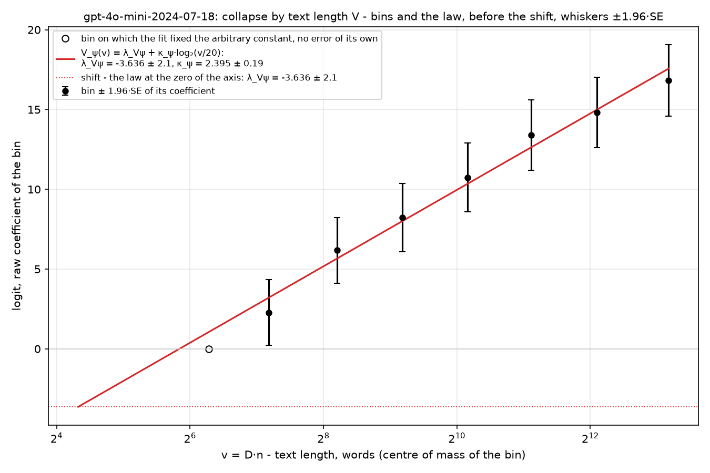

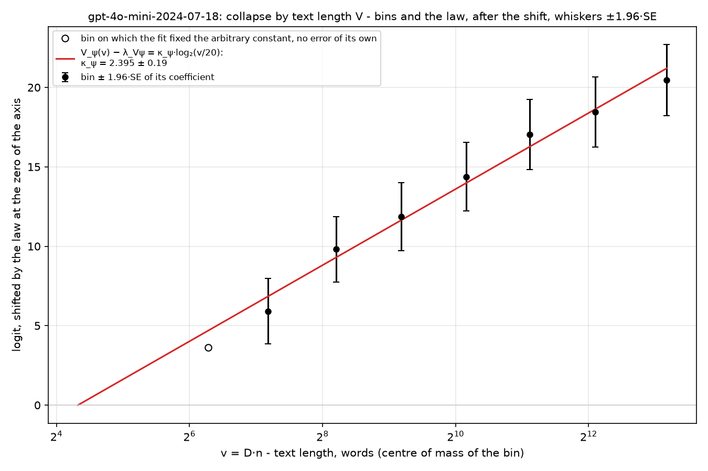

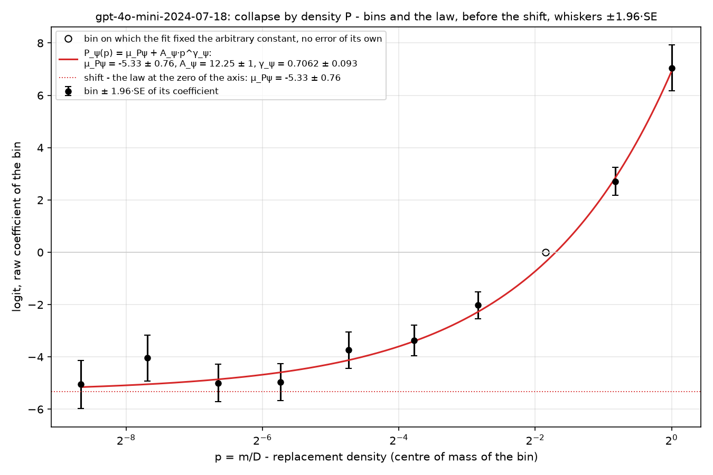

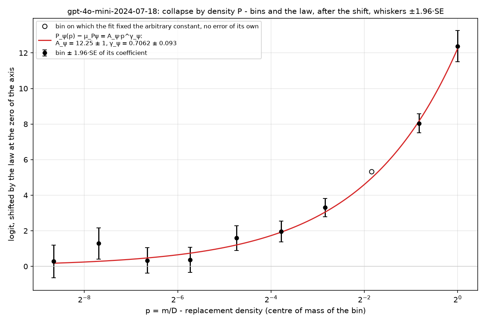

### Place

The probability F that a point which lost the text has lost it by the word s. Every replacement word of the 995 points that lost the text is one trial - 365955 trials, 180097 of them on or after the line where the answer lost the text; the layout and the weights are those of these points. All laws are drawn over the full covariance of their bins:

$$\ln\frac{F}{1 - F} = \alpha_F + S_F(\text{bin of } s) + P_F(\text{bin of } p) + Q_F\big(\text{bin of } \tfrac{s - 1}{v}\big)$$

$$S_F(s) = \mu_{SF} + \tfrac{\kappa_{SF}}{2}\Big[\log_2\tfrac{s}{s_*} + \sqrt{\log_2^2\tfrac{s}{s_*} + \omega_{SF}^2}\Big], \qquad P_F(p) = \mu_{PF} + A_F\, p^{\gamma_F}, \qquad Q_F = \lambda_{QF} + \kappa_{QF}\,\tfrac{s - 1}{v}$$

$$\ln\frac{F}{1 - F} = \lambda_F + \tfrac{\kappa_{SF}}{2}\Big[\log_2\tfrac{s}{s_*} + \sqrt{\log_2^2\tfrac{s}{s_*} + \omega_{SF}^2}\Big] + A_F\, p^{\gamma_F} + \kappa_{QF}\,\tfrac{s - 1}{v}, \qquad \lambda_F = \alpha_F + \mu_{SF} + \mu_{PF} + \lambda_{QF}$$

- weighting by the cells of the run cube V × P × M: 161 cells, 995 points, largest occupancy 41; effective points n_eff = 475.68

| Parameter | Value ± 1.96·SE | Note |
|---|---|---|
| λ_F | -10.65 ± 1.99 | logit of the place on the plateau, at p → 0, at the start |
| κ_SF | 1.14 ± 0.209 | rise past the corner, logit per doubling of the word |
| s_* | 39.57 ± 22.63 | corner: the word number where the asymptotes cross |
| ω_SF | 0.00100 (held on its bound) | width of the corner, doublings of the word number |
| A_F | 6.95 ± 1.56 | density term at the full density p = 1 |
| γ_F | 0.420 ± 0.155 | exponent of the density term |
| κ_QF | 3.19 ± 0.589 | rise over the whole text, logit |
| μ_SF | -5.15 ± 1.37 | word shift: the plateau of the word law, s → 0 |
| μ_PF | -3.99 ± 1.53 | density shift: the density law at p → 0 |
| λ_QF | -0.130 ± 0.640 | share shift: the share line at the start of the text |
| χ² / points, `place_word` | 4.53 / 10 | the law against its bins |
| χ² / points, `place_density` | 9.09 / 10 | the law against its bins |
| χ² / points, `place_share` | 42.91 / 9 | the law against its bins |

The bins are fitted on 365955 trials (180097 with the text lost); a bin whose trials all have one outcome has no estimate and goes out with its trials: none. The coefficients are raw logits relative to the reference bin of the axis (`0`), before the shift.

| Axis | Bin | Value ± 1.96·SE |
|---|---|---|
| word number s | 1–10 | -5.02 ± 1.71 |
| word number s | 11–20 | -5.08 ± 1.52 |
| word number s | 21–40 | -5.16 ± 1.48 |
| word number s | 41–80 | -4.70 ± 0.988 |
| word number s | 81–160 | -3.17 ± 0.881 |
| word number s | 161–320 | -2.21 ± 0.646 |
| word number s | 321–640 | -0.951 ± 0.411 |
| word number s | 641–1280 | 0.00 |
| word number s | 1281–2560 | 1.11 ± 0.434 |
| word number s | 2561–5120 | 2.42 ± 0.850 |
| word number s | 5121–10240 | 3.15 ± 1.34 |
| replacement density p | 1/1024–1/512 | -3.12 ± 2.51 |
| replacement density p | 1/512–1/256 | -4.40 ± 1.33 |
| replacement density p | 1/256–1/128 | -3.26 ± 1.14 |
| replacement density p | 1/128–1/64 | -3.17 ± 1.04 |
| replacement density p | 1/64–1/32 | -3.47 ± 1.19 |
| replacement density p | 1/32–1/16 | -2.83 ± 1.08 |
| replacement density p | 1/16–1/8 | -2.01 ± 0.947 |
| replacement density p | 1/8–1/4 | -1.09 ± 0.796 |
| replacement density p | 1/4–1/2 | 0.00 |
| replacement density p | 1/2–1 | 1.64 ± 0.696 |
| replacement density p | 1 | 2.84 ± 0.830 |
| share of the text (s − 1)/v | 0–0.1 | 0.00 |
| share of the text (s − 1)/v | 0.1–0.2 | 0.311 ± 0.654 |
| share of the text (s − 1)/v | 0.2–0.3 | 0.882 ± 0.783 |
| share of the text (s − 1)/v | 0.3–0.4 | 1.16 ± 0.831 |
| share of the text (s − 1)/v | 0.4–0.5 | 1.65 ± 0.836 |
| share of the text (s − 1)/v | 0.5–0.6 | 1.27 ± 0.918 |
| share of the text (s − 1)/v | 0.6–0.7 | 1.68 ± 0.924 |
| share of the text (s − 1)/v | 0.7–0.8 | 2.02 ± 0.912 |
| share of the text (s − 1)/v | 0.8–0.9 | 2.42 ± 0.905 |
| share of the text (s − 1)/v | 0.9–1 | 3.21 ± 0.907 |

Check, the text length: the bins of the text length fitted together with the bins above; Wald statistic «all of them are zero» 13.89 with 7 degrees of freedom, p = 0.0531; the largest change of a bin above 2.32 of its SE.

| Text length | Value ± 1.96·SE |
|---|---|
| 41–80 | 0.00 |
| 81–160 | -0.155 ± 0.902 |
| 161–320 | -0.132 ± 1.13 |
| 321–640 | -0.645 ± 1.34 |
| 641–1280 | -0.112 ± 1.55 |
| 1281–2560 | 0.171 ± 1.66 |
| 2561–5120 | 0.669 ± 1.87 |
| 5121–10240 | 1.62 ± 2.18 |

Check, the number of rules: the bins of the number of rules fitted together with the bins above; Wald statistic «all of them are zero» 27.74 with 8 degrees of freedom, p = 0.000526; the largest change of a bin above 1.06 of its SE.

| Number of rules | Value ± 1.96·SE |
|---|---|
| 1 | 0.00 |
| 2 | -0.902 ± 0.995 |
| 3–4 | -1.10 ± 0.761 |
| 5–8 | -0.497 ± 0.688 |
| 9–16 | -1.09 ± 0.732 |
| 17–32 | -1.44 ± 0.768 |
| 33–64 | -1.15 ± 0.857 |
| 65–128 | -1.90 ± 0.961 |
| 129–256 | -0.313 ± 1.62 |

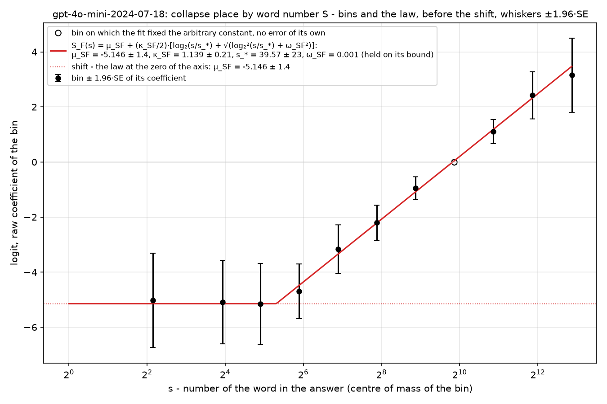

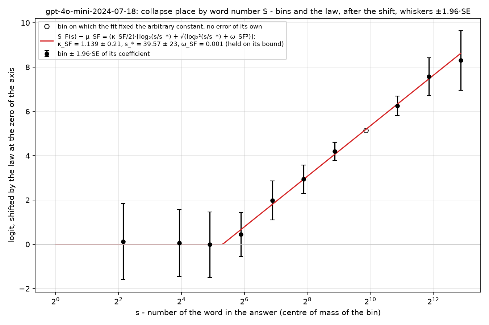

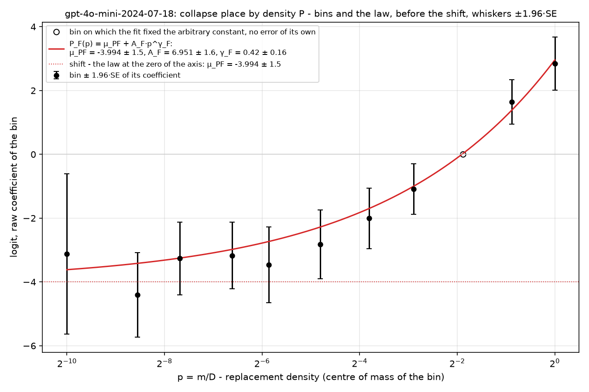

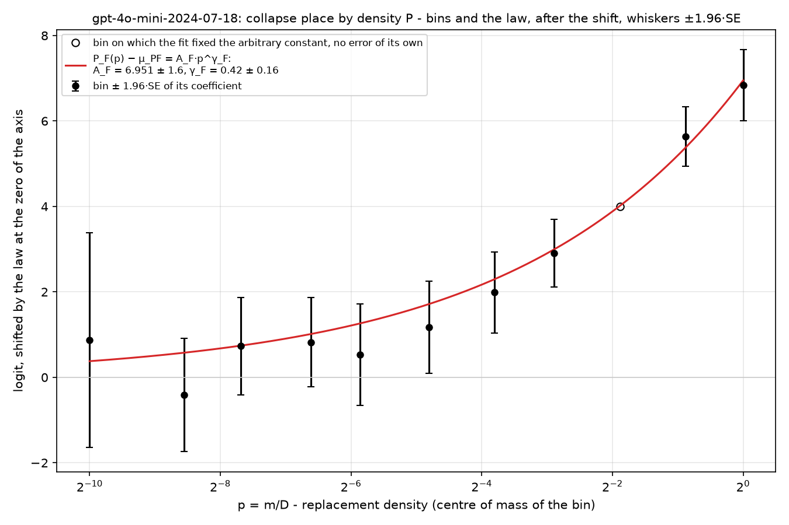

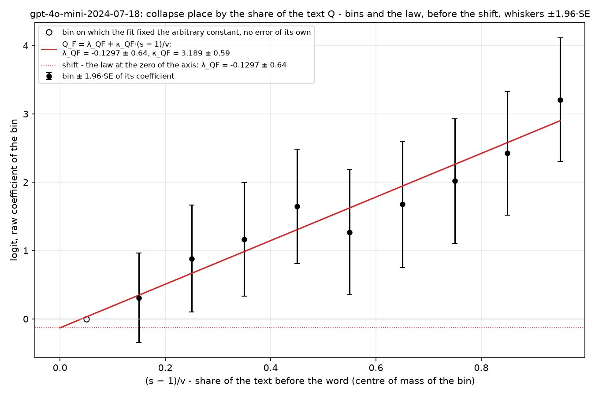

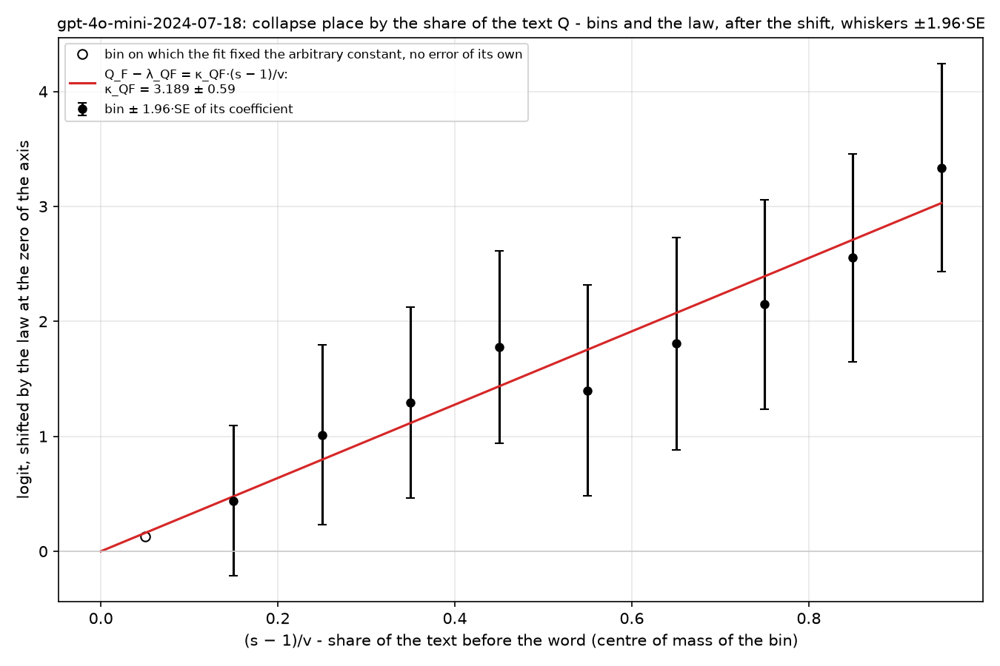

## Bin cube filling

```text
bin cube: point counts by bins D × m × n

m ∈ 1
D\n         1-5   6-10  11-20  21-40  41-80 81-160161-320321-640
1-4           3      3      3      3      3      9     39      3
5-8           3      3      3      3      6      8      3      3
9-16          3      3      3      3      3     29     27     50
17-32         3      3      3      3      3     11      3      x
33-64         3      3      3      5      6     15      x      x
65-128        3      6      6     10      3      x      x      x
129-256       3     22     24      3      x      x      x      x
257-512       3      7     11      x      x      x      x      x
513-1024      3      3      x      x      x      x      x      x

m ∈ 2
D\n         1-5   6-10  11-20  21-40  41-80 81-160161-320321-640
1-4           4      4      4     27      6     37      3      x
5-8           3      3      3      3      3      9      3      x
9-16          3      3      3      3      8      3      3      3
17-32         3      3      9      6     10     12      3      x
33-64         3      3      3     19     18      3      x      x
65-128        3      3      3     14     16      x      x      x
129-256       3      3     24     44      x      x      x      x
257-512       3     14      3      x      x      x      x      x
513-1024      7     12      x      x      x      x      x      x

m ∈ 3-4
D\n         1-5   6-10  11-20  21-40  41-80 81-160161-320321-640
1-4           3      3     11     50      3      3      x      x
5-8           3      3      6      6      3      3      x      x
9-16          4      3      5      5      3      x      x      x
17-32         5      8      5      7     28      3      x      x
33-64         6      3      3     11     37      3      x      x
65-128        6      3     14     26      3      x      x      x
129-256       6      3      3      3      x      x      x      x
257-512      15     14     15      x      x      x      x      x
513-1024     41     26      x      x      x      x      x      x

m ∈ 5-8
D\n         1-5   6-10  11-20  21-40  41-80 81-160161-320321-640
1-4           x      x      x      x      x      x      x      x
5-8           6     18     46      3      x      x      x      x
9-16          6     29     46     68      3      x      x      x
17-32        19     20     11     14     40      3      x      x
33-64         6      3      6      5     75      3      x      x
65-128        6     10     12     40      3      x      x      x
129-256      15     17     11      3      x      x      x      x
257-512      40     23     37      x      x      x      x      x
513-1024      3      3      x      x      x      x      x      x

m ∈ 9-16
D\n         1-5   6-10  11-20  21-40  41-80 81-160161-320321-640
1-4           x      x      x      x      x      x      x      x
5-8           x      x      x      x      x      x      x      x
9-16         44     20      3      3      x      x      x      x
17-32         8     26     23      3      3      x      x      x
33-64         6      5      9      3      3      x      x      x
65-128        9      6     25      3      x      x      x      x
129-256      12     15      3      x      x      x      x      x
257-512      21     22      3      x      x      x      x      x
513-1024     17      3      x      x      x      x      x      x

m ∈ 17-32
D\n         1-5   6-10  11-20  21-40  41-80 81-160161-320321-640
1-4           x      x      x      x      x      x      x      x
5-8           x      x      x      x      x      x      x      x
9-16          x      x      x      x      x      x      x      x
17-32        91      3      3      x      x      x      x      x
33-64        29     31      3      x      x      x      x      x
65-128       17     12     42      3      x      x      x      x
129-256      11     20     50      3      x      x      x      x
257-512      25     42      3      x      x      x      x      x
513-1024      3      3      x      x      x      x      x      x

m ∈ 33-64
D\n         1-5   6-10  11-20  21-40  41-80 81-160161-320321-640
1-4           x      x      x      x      x      x      x      x
5-8           x      x      x      x      x      x      x      x
9-16          x      x      x      x      x      x      x      x
17-32         x      x      x      x      x      x      x      x
33-64        63      3      x      x      x      x      x      x
65-128       76     61      3      x      x      x      x      x
129-256      32      3      3      x      x      x      x      x
257-512       3      3      x      x      x      x      x      x
513-1024      x      x      x      x      x      x      x      x

m ∈ 65-128
D\n         1-5   6-10  11-20  21-40  41-80 81-160161-320321-640
1-4           x      x      x      x      x      x      x      x
5-8           x      x      x      x      x      x      x      x
9-16          x      x      x      x      x      x      x      x
17-32         x      x      x      x      x      x      x      x
33-64         x      x      x      x      x      x      x      x
65-128        3      3      x      x      x      x      x      x
129-256      73      3      x      x      x      x      x      x
257-512      74      3      x      x      x      x      x      x
513-1024      3      x      x      x      x      x      x      x

m ∈ 129-256
D\n         1-5   6-10  11-20  21-40  41-80 81-160161-320321-640
1-4           x      x      x      x      x      x      x      x
5-8           x      x      x      x      x      x      x      x
9-16          x      x      x      x      x      x      x      x
17-32         x      x      x      x      x      x      x      x
33-64         x      x      x      x      x      x      x      x
65-128        x      x      x      x      x      x      x      x
129-256       3      x      x      x      x      x      x      x
257-512       3      x      x      x      x      x      x      x
513-1024      3      x      x      x      x      x      x      x
```
